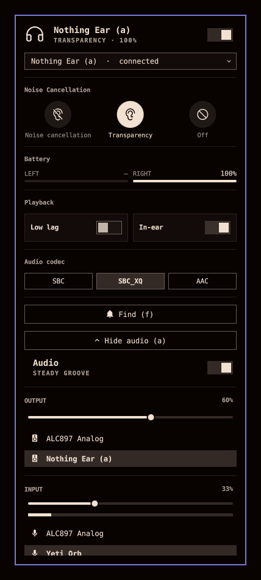

# Too Much Nothing

ANC, battery and playback controls for Nothing and CMF earbuds, several pairs
of them, plus the system audio controls, as one Omarchy bar widget.

Forked from [Nothing Buds](https://github.com/SaiAungMinKhant/omarchy-nothing-buds)
by Sai Aung Min Khant, which stays the lean, earbuds-only plugin. This fork
grows it into more of a suite. Fixes that belong upstream go upstream.



The panel follows your Omarchy theme. Both shots are the same build, on CMF
Buds 2.

- A dot on the bar icon carries the mode. Filled for ANC, hollow for
  transparency, drained when off or disconnected.
- Noise control: off, transparency, and ANC at low, mid, high or adaptive.
- Per-bud and case battery. The meter turns urgent below 20% and pulses while
  charging.
- Low lag mode and in-ear detection.
- Ultra bass with five levels, and spatial audio, on CMF Buds 2 and Nothing
  Ear (3). Super Mic on Ear (3). The panel shows what the model reports.
- Audio codec, switched through PipeWire. Switching interrupts playback for a
  few seconds while the link renegotiates.
- Connect and disconnect the buds from the panel header.
- Find my buds. It asks first, since the tone is loud enough to hurt a bud
  still in an ear. The tone stops itself after 8 seconds.
- System audio, folded away under an "Audio" button at the bottom (or `a`):
  the same controls as Omarchy's audio panel. A mute switch, output volume
  and device picker, input volume with a level meter and device picker, and
  a per-app mixer. Arrows or h/j/k/l move through them, Enter picks, `m`
  mutes. Scrolling on the bar icon changes the volume with the on-screen
  display, and right-click mutes, as on Omarchy's audio icon. With these
  here you can turn `omarchy.audio` off and keep one icon.

Developed against CMF Buds 2 (B179). Other Nothing and CMF models speak the
same protocol on a different RFCOMM channel. The panel probes for the right
one when the buds stay silent, and that is how Nothing Ear (3) works with it.
See [RFCOMM channel](#rfcomm-channel).

## Requirements

| | |
|---|---|
| [earctl](https://github.com/DaanHessen/earctl) | Speaks the Nothing RFCOMM protocol. AGPL-3.0. This plugin calls it as a separate program over its local HTTP API and does not bundle it. Setup builds missing earctl from an exact pinned commit, using its Cargo.lock |
| `bluez-utils` | `bluetoothctl`, for link state and connect/disconnect |
| `jq` | The wrapper builds its JSON output with it |
| `perl` | Reads config and state files without following symlinks. Git already depends on it |

Dependencies are invoked by absolute path (`/usr/bin/bluetoothctl`,
`/usr/bin/jq`, `/usr/bin/perl`, `/usr/bin/earctl` or the recorded one below, `omarchy-launch-tui`
at `/usr/bin/omarchy-launch-tui`), never through PATH and never through an
environment override. If your distribution puts them somewhere else, symlink
or adjust with full knowledge of that fact.

## Install

```sh
omarchy plugin add https://github.com/lutzlstein/too-much-nothing.git --enable
```

**Setup only ever runs from a click.** Enabling the plugin never modifies
anything by itself. The panel opens with a short list of what setup installs
and a "Set up now" button. The click is the consent. The panel then runs
`setup/install.sh --yes`.

What that click installs:

- the `tmn` wrapper into `~/.local/bin`,
- `tmn-earctl.service`, a systemd **user** service that keeps the RFCOMM
  session open, serving on `127.0.0.1:8797`,
- a pinned earbuds address in `~/.config/too-much-nothing`, when exactly one
  Nothing or CMF device is paired,
- earctl itself, if it is not already on the machine, or a rebuild of one
  this plugin built from an older pin.

Nothing runs as root and installation never asks for a password. If earctl is
missing, or was built by this plugin from an older pin, setup stops and the
panel offers an "Install earctl" button that opens a terminal, where the
installer prints its plan and asks `Proceed? [y/N]` before doing anything. Have Git, a Rust toolchain (Cargo),
and the native build dependencies for earctl available first.

Missing earctl is always built from commit
`1315bfbf07eb74b946606e30ede2d4290449082f`, upstream master as of
2026-09-13 with Ear (3), Super Mic, spatial audio and CMF Buds 2 support.
Setup fetches that exact commit, checks it out detached, verifies HEAD, and
runs `cargo build --release --locked` so dependency resolution must match the
committed lockfile. The binary goes into
`~/.local/share/io.github.lutzlstein.too-much-nothing/bin/earctl`, never
`~/.local/bin`, and the commit
is recorded next to the manifest. When a later version of this plugin moves
the pin, setup sees the recorded commit no longer matches and rebuilds, in a
terminal. Setup never installs an AUR package, even when `yay` is available.
An earctl package at `/usr/bin/earctl` is reused as a user-provided
dependency and never rebuilt. One in `~/.local/bin` is ignored, since it may
belong to Nothing Buds or something else.
If it predates the pinned commit, the extra controls stay hidden until you
update it yourself.

Every file is written by temp file and rename, never through a symlink,
recorded in a manifest at
`~/.local/state/io.github.lutzlstein.too-much-nothing/`, and backed up before
replacement. A pre-existing file counts as ours only when the manifest
records it or it is byte-identical to a version this plugin ships or has
shipped. Anything else is refused with exit 5 rather than overwritten.
`--replace-existing` overrides that for a human who wants it, keeping the old
copy in the `backup/` directory.

The panel decides whether to offer setup by running `install.sh --check`,
which exits 0 only when the wrapper is present and byte-identical to the one
in the plugin folder, the unit exists, earctl is found, and an earctl this
plugin built matches the pinned commit. It changes nothing and asks nothing.

Installer exit codes: `0` done · `1` (`--check` only) missing or out of date ·
`2` earctl missing or built from an older pin, needs a terminal · `3` base dependency missing · `4`
consent not given · `5` pre-existing object refused · `6` operational failure
(everything rolled back).

You can also run the installer directly:

```sh
~/.config/omarchy/plugins/io.github.lutzlstein.too-much-nothing/setup/install.sh
```

Run by hand it prints its plan and asks before proceeding, and installs earctl
too, since it has a terminal to work with. A failed run rolls back everything
it did, restoring backups.

**Coming from Nothing Buds.** The two install side by side: different
plugin ID, wrapper, unit, config and state folders, earctl location and
server port. Only one of them should talk to the buds, though, so turn the
other off (see Notes). On first setup this plugin copies your earbuds pick
and discovered channels from Nothing Buds' state folder, once, and never
touches that folder. To remove Nothing Buds entirely, run its own
`setup/uninstall.sh`, then `omarchy plugin remove io.github.saiaungminkhant.nothing-buds`.

## Uninstall

```sh
~/.config/omarchy/plugins/io.github.lutzlstein.too-much-nothing/setup/uninstall.sh
omarchy plugin remove io.github.lutzlstein.too-much-nothing
```

Run them in that order. `omarchy plugin remove` deletes the plugin folder and
nothing else, and the uninstall script lives inside it.

The uninstall is manifest-driven. It removes exactly the objects recorded at
install time, and only while they are still provably ours, meaning the same
recorded hash and not currently a symlink. Files you edited are left alone, directories
are removed only when empty, and an earctl this plugin never installed is
never touched. The manifest itself and the backups go too.

The built earctl binary is removed by exact recorded path and hash, along
with the record of the commit it was built from. For
compatibility with version 0.0.2, an earctl package recorded by that version
is still removed through the package manager (`yay -Rns`, which may ask for
a password). New installations never create package records. Pass
`--keep-earctl` if something else on your system uses it.

Installs made before the manifest existed get the safe subset: only the
wrapper and unit are removed, and only if their content still matches a
version this plugin ships or has shipped. Everything else is listed for manual
cleanup.

## Configuration

The wrapper resolves your earbuds' address in this order:

1. `--address`
2. the pair picked in the panel, if it is still paired
3. `~/.config/too-much-nothing/address`, while that pair is connected
4. the first connected device whose name looks like a Nothing or CMF product
5. `~/.config/too-much-nothing/address`
6. the first paired one

`install.sh` writes the config file for you when exactly one such device is
paired. The RFCOMM channel resolves the same way: `--channel`, then
`~/.config/too-much-nothing/channel`, then the one discovery found for that address,
then the single channel file versions up to 0.0.8 kept, else 16.
Values are validated. An address must match `AA:BB:CC:DD:EE:FF` and a
channel must be 1 to 63. Anything that fails is ignored with a note rather
than passed to a command.

### More than one pair

Every paired Nothing or CMF device is listed. When there are two or more, the
panel shows a picker under the header. The panel controls one pair at a time,
because earctl keeps a single RFCOMM session. Without a pick it follows the
pair that is connected. Picking a pair links it if it is not linked, and the
session moves to it on the next read. The pick is kept in
`~/.local/state/io.github.lutzlstein.too-much-nothing/selected`, and it
outranks `~/.config/too-much-nothing/address`, which only names a default. From a terminal:

```sh
tmn list                       # every pair, which is connected, the pick
tmn select AA:BB:CC:DD:EE:FF
tmn select none             # back to following the connected pair
```

Every command checks which buds the earctl session belongs to before it
reads or writes. A session left on another pair is closed and a new one
opened, so a setting always lands on the buds you see in the panel.

To pin per-widget instead, add keys to this widget's entry in
`~/.config/omarchy/shell.json`:

```json
{ "id": "io.github.lutzlstein.too-much-nothing", "address": "AA:BB:CC:DD:EE:FF", "channel": 16 }
```

The panel validates these too and shows "Ignoring invalid address/channel in
shell.json" if one fails the grammar, instead of building a command with them.
A pinned address hides the picker.
The `EARBUDS_ADDR`, `EARBUDS_CHANNEL` and `EARCTL` environment variables from
the first release are gone. An environment variable can steer which
executable runs or what it reads, and this plugin no longer has any such
path.

### RFCOMM channel

earctl finds the channel with `sdptool`. Arch no longer ships it, and it now
lives in AUR `bluez-utils-compat`, so the wrapper defaults to 16 instead.
Other models listen elsewhere:

| Model | RFCOMM channel | Confirmed by |
|---|---|---|
| CMF Buds 2 (B179) | 16 | me |
| Nothing Ear (3) (B173) | 15 | [@kasemeyer](https://github.com/SaiAungMinKhant/omarchy-nothing-buds/issues/2) |
| Nothing Ear (a) (B162) | 15 | multi-device testing |

A wrong channel does not fail loudly. The link opens and the buds never
answer. When the panel sees that twice in a row on a live link, it runs
`tmn discover-channel`, which tries the known channels first and then 1
to 30, and accepts only a channel that returns a battery reading. Accepting
the link is not proof. On my CMF Buds 2 five channels opened and four of them
stayed quiet. The panel shows which channel it is trying, then "Found your
earbuds on channel N". The answer is remembered per device in
`~/.local/state/io.github.lutzlstein.too-much-nothing/channels/`, one file
named after the address, so CMF Buds 2 and an Ear (3) each keep their own.
The wrapper reads it after `~/.config/too-much-nothing/channel`, and uninstall removes
it.

Discovery runs once per link and never when a channel is pinned in
`shell.json` or `~/.config/too-much-nothing/channel`. A pinned channel that stays
silent is reported instead. Every probe has a deadline, 5s to disconnect, 8s
to connect and 8s to read, so a device that answers nowhere costs about ten
minutes and a known model a few seconds. You can run it by hand too:

```sh
tmn discover-channel
```

If your model is not in the table and discovery found it, please open an
issue with the model and channel.

## What is not here

None of these are hardware limits. The Nothing X app drives both on the
same earbuds.

| | |
|---|---|
| Equalizer | `eq get` always reads back mode 0 on CMF Buds 2, whatever the app shows, so the preset ids are unmapped |
| Gestures | earctl decodes them now (`earctl gestures get`), but the panel has no gesture editor |

## Security

Nothing Buds was written to the Omarchy marketplace review requirements
below. This fork keeps every mechanism and test, but it has not been
reviewed itself.

| Requirement | Mechanism |
|---|---|
| Dependency installation must use the reviewed source | Missing earctl is built only from the full commit above, with detached checkout and HEAD verification before Cargo runs. `--locked` requires the committed dependency lockfile. The built commit is recorded, so a moved pin rebuilds rather than keeping an older binary. There is no AUR installation path. S5, S5a, S5c |
| Setup must be an explicit, consented action; no overwriting objects the plugin cannot prove it owns | Setup runs only from the panel's "Set up" click (`--yes`) or a y/N prompt in a terminal. `setup/lib.sh` installs through `nb_install_file`: symlinked targets are refused, pre-existing files are refused unless recorded in the manifest or byte-identical to a version shipped here, replaced files are backed up, and everything is published by atomic rename. The panel only ever probes with `install.sh --check`, which is read-only. `bash setup/test.sh` S1, S6, S7, S9, S15, S16 |
| Uninstall must remove only what this installation created | A manifest at `~/.local/state/io.github.lutzlstein.too-much-nothing/` records every file, directory and package created. Removal is hash-checked, symlink-checked, empty-dir-only, and never recurses by inference. Legacy installs get content-matching only. S3, S8, S11, S12 |
| Helper calls need deadlines and output caps; a hung or noisy helper must not wedge the panel | Every wrapper call is wrapped in `/usr/bin/timeout` with byte caps on consumed output, and each helper runs in its own process group so a forked grandchild dies with it; the panel wraps every operation in `/usr/bin/timeout --kill-after=5 <deadline>`, streams stdout/stderr through capped parsers, and a watchdog plus supersession rules guarantee `busy`/link state always clears. Channel discovery is a fixed list of bounded probes, writes only inside the plugin's own state directory by temp file and rename, and refuses a symlink there. S13, S17 |
| Executable identity and input boundaries must not be steerable | All binaries are invoked by absolute path; the `EARCTL`/`EARBUDS_ADDR`/`EARBUDS_CHANNEL` overrides are removed; the panel passes overrides as validated arguments; config and state files are opened once with `O_NOFOLLOW\|O_NONBLOCK`, checked with `fstat` on that same descriptor and read with a byte cap, so a swapped-in symlink or FIFO is refused rather than followed or waited on; they are validated against a Bluetooth-address grammar before use. S14 |

`setup/test.sh` runs all of this against fakes in a throwaway HOME, with no
root, no network and no real systemd, and is the evidence for the table above.

## Notes

Only one program can hold the Nothing RFCOMM socket at a time. BudsLink,
ear-web, Nothing Buds and this plugin will fight over it. Stop the service before you run
another one:

```sh
systemctl --user stop tmn-earctl.service   # this plugin
systemctl --user stop earctl.service       # Nothing Buds
```

## Licenses

MIT. See [LICENSE](LICENSE), which keeps the original Nothing Buds
copyright alongside this fork's.

The bundled [Phosphor Icons](https://phosphoricons.com) path data is also MIT.
Its notice is in [licenses/phosphor-LICENSE](licenses/phosphor-LICENSE).
`ConfirmCard.qml` is adapted from the Omarchy shell's ConfirmDialog, and
`AudioSection.qml` and `AudioModel.js` from its audio panel, all MIT, with the
notice in [licenses/omarchy-LICENSE](licenses/omarchy-LICENSE).

Not affiliated with, endorsed by, or connected to Nothing Technology Limited.
"Nothing", "CMF" and the product names are their trademarks, used here only to
say what this controls.
